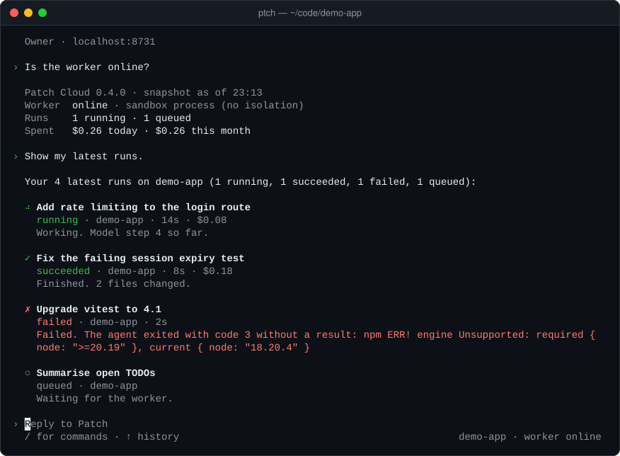
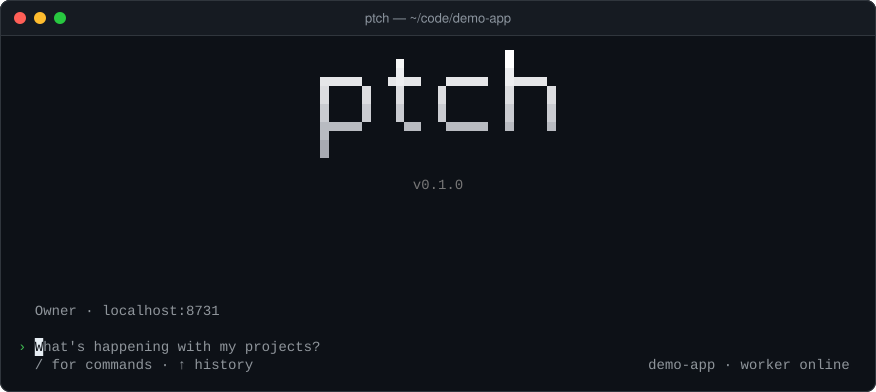
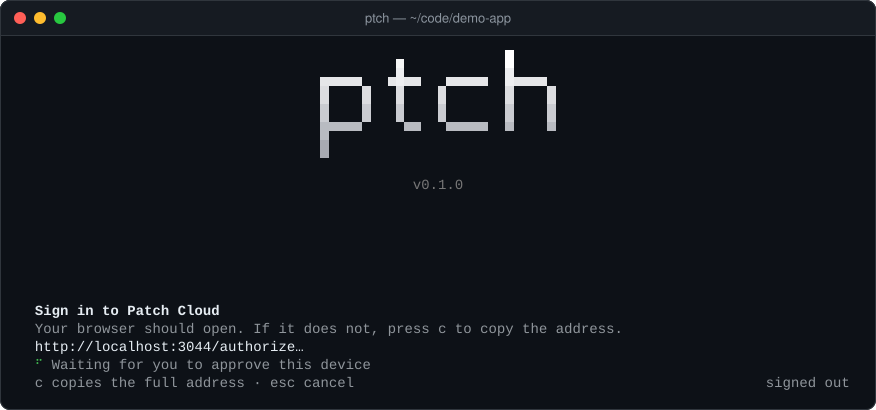
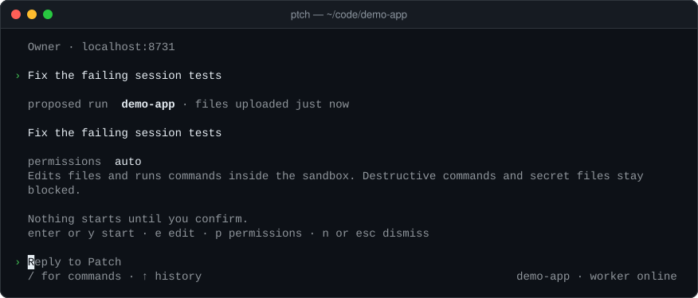
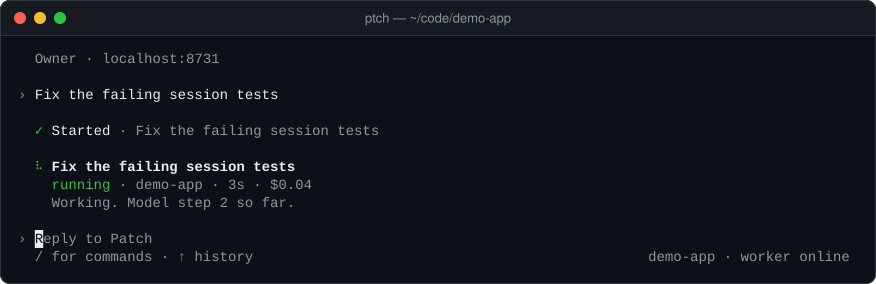
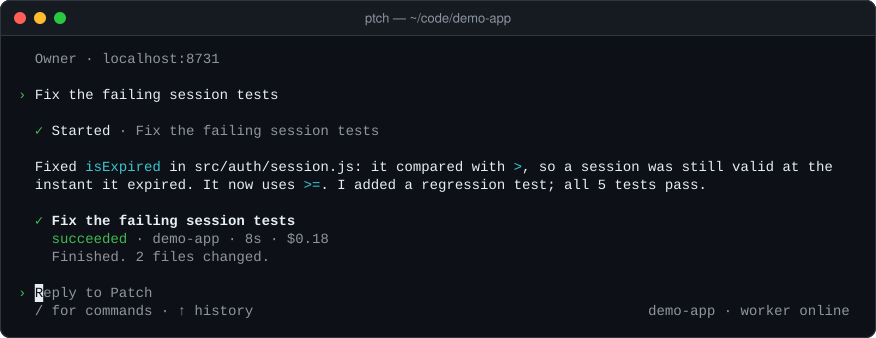
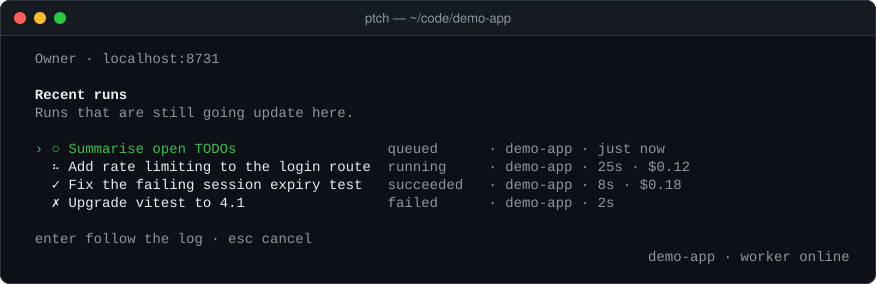
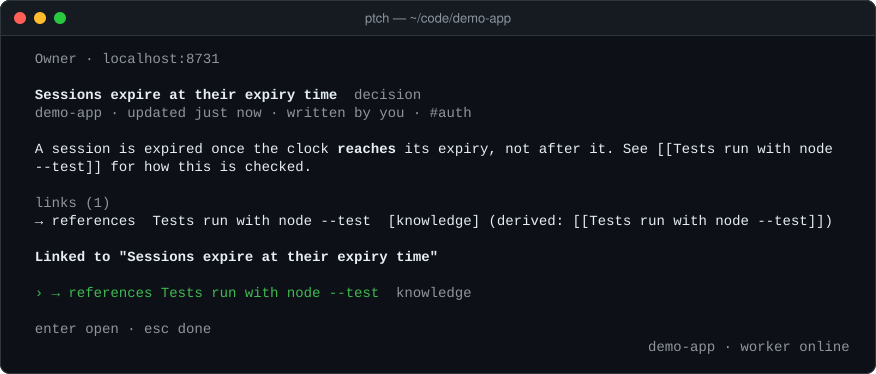

<p align="center">
  <picture>
    <source media="(prefers-color-scheme: dark)" srcset="docs/images/logo-dark.svg">
    
  </picture>
</p>

<p align="center"><b>The terminal window into Patch Cloud.</b></p>

<p align="center">
  <a href="https://github.com/xcrrr/ptch/actions/workflows/ci.yml"></a>
  <a href="LICENSE"></a>
  
  
</p>

Patch is a coding agent that works in the cloud. Describe the work, hand it off, watch it run, review the result, from your terminal, the web or your phone. `ptch` is the open-source command-line client: it reads your repository, shows you the file list before anything leaves your machine, uploads it to Patch Cloud only after you say yes, and brings the result back as a patch you can review and apply.

<p align="center">
  
</p>

<p align="center"><sub>Ask in plain language; here Patch answers from live Patch Cloud status. Illustrative: this window was captured from the built <code>ptch</code> against a test instance of Patch Cloud on localhost, with a stand-in agent and no model calls, so the runs, durations and costs are made up, and the test instance runs tasks without isolation.</sub></p>

> **Status: private beta.** Patch Cloud, the hosted service, is invitation-only. The `ptch` CLI in this repository is open source under the MIT license, and you need an invitation to use it with Patch Cloud. Anthropic's Claude models are the only model provider. Expect rough edges; see [Limitations](#limitations).

## Contents

- [What Patch is](#what-patch-is) · [Quick start](#quick-start) · [First run](#first-run) · [Hand a task off](#hand-a-task-off) · [How it works](#how-it-works) · [Status](#status)
- [Commands](#commands) · [Print mode](#print-mode) · [Permissions](#permissions) · [Configuration](#configuration) · [Privacy and security](#privacy-and-security)
- [Architecture](#architecture) · [Development](#development) · [Roadmap](#roadmap) · [FAQ](#faq) · [Limitations](#limitations)
- [Contributing](#contributing) · [Security](#security) · [License](#license)

## What Patch is

- **Hand-off, not babysitting.** You describe a task in plain language. Patch works on it in an isolated environment, so the work keeps going when you close the terminal or put your phone away.
- **One account, three windows.** The `ptch` terminal view, Patch HQ on the web and the Android app show the same projects, runs and history. Start in one, check in from another.
- **You review before anything lands.** A finished run gives you an answer and a patch. Nothing in your working tree changes until you run `ptch cloud apply <run> --apply`, and nothing is committed or pushed for you.
- **A project memory.** The Brain holds what a project should remember: knowledge, decisions and notes. You can read, search and add to it from any window: `/brain` in the terminal view, or `ptch cloud brain` in scripts.
- **You can see what it sends.** The client is open source, and every upload shows its file list and asks first.

## Quick start

You need Node.js 20.19 or newer, pnpm 9 and Git, and an invitation to Patch Cloud.

```bash
git clone https://github.com/xcrrr/ptch.git
cd ptch
pnpm install
pnpm build
pnpm setup && pnpm link --global      # puts ptch on your PATH; open a new terminal afterwards
ptch login                            # opens your browser; approve this device
```

Then run `ptch` in any project. The executable is called `ptch` because `patch` is a standard Unix utility. Windows notes, installing from a release tarball and updating are in [docs/install.md](docs/install.md). Access is by invitation; ask for it on the [Patch site](https://ptch.vercel.app).

## First run

```bash
cd ~/code/your-project
ptch
```

`ptch` opens Patch Cloud in your terminal: a chat-first screen that works the same way as Patch HQ on the web. It takes the project from the folder you started in, shows the account and the state of the worker, and waits for you to type.

<p align="center">
  
</p>

<p align="center"><sub>The start screen. Illustrative: a window from a test instance of Patch Cloud on localhost.</sub></p>

### Signing in

Signed out, the same command begins with the sign-in. It opens your browser, waits for you to approve the device there, and shows the address in case the browser does not open (`c` copies it):

<p align="center">
  
</p>

<p align="center"><sub>Waiting for the device to be approved in the browser. Illustrative: the address points at a test instance on localhost.</sub></p>

`ptch login`, `ptch logout` and `ptch whoami` do the same outside the view, and `/login`, `/logout` and `/whoami` inside it. Sign-in uses the OAuth authorization code flow with PKCE and a loopback redirect on `127.0.0.1`; the site never sees your terminal's token, and `ptch` never sees your password. Access and refresh tokens are kept in your operating system's keystore (Windows DPAPI, macOS Keychain, Linux Secret Service), or in a private file with user-only permissions where there is none. Without a browser (SSH, containers), set `PATCH_NO_BROWSER=1`; `PATCH_SITE` or `--site <url>` signs in at a different Patch site.

### Talking to it

Talk to it in your own words, as in the picture at the top. Questions about your projects and runs are answered from live Patch Cloud data; a request to change code becomes a proposed run that you confirm before anything starts. `ptch "fix the failing session tests"` opens the view with a first message already sent. `ptch --continue` reopens the most recent conversation and `ptch --resume [id]` an earlier one (without an id you choose from a list).

Type `/` in the view to see the commands:

| Command                | What it does                                                          |
| ---------------------- | --------------------------------------------------------------------- |
| `/new`                 | Start a new conversation.                                             |
| `/resume [id]`         | Open an earlier conversation.                                         |
| `/projects`            | List cloud projects and choose the one to work in.                    |
| `/runs`                | Recent runs; open one to follow its log.                              |
| `/run <id>`            | Follow the log of one run.                                            |
| `/brain [add <title>]` | Read this project's Brain, or add an entry.                           |
| `/push`                | Upload this repository as a new snapshot (you confirm the file list). |
| `/login`               | Sign in to Patch Cloud in your browser.                               |
| `/logout`              | Sign this device out.                                                 |
| `/whoami`              | Who you are signed in as, and where.                                  |
| `/help`                | Commands and keys.                                                    |
| `/quit`                | Leave Patch (`/exit` works too).                                      |

Keys: Enter sends; Esc cancels what is open, or stops following a run (the run keeps going); Ctrl+C cancels what is open, clears the prompt, and pressed twice leaves. `ptch` needs an interactive terminal; in scripts and CI use the [`ptch cloud` subcommands](#commands).

## Hand a task off

A run works on a snapshot of your repository that lives on Patch Cloud. Uploading it is a step of its own, and it is the only moment your files leave your machine:

1. **Upload a snapshot** with `/push` in the view (or `ptch cloud submit`, which uploads and starts a run in one command after the same confirmation). `ptch` lists the files it would upload and asks you to confirm; only what that list showed is uploaded.
2. **Ask for the change.** Patch answers with a proposed run: the project, how old the snapshot it will use is, your prompt, and the permission profile. Nothing starts until you confirm.

<p align="center">
  
</p>

<p align="center"><sub>A proposed run. It names the snapshot's age (here "files uploaded just now"), not a file list. Enter or <code>y</code> starts it, <code>e</code> edits the prompt, <code>p</code> changes the permissions, <code>n</code> or Esc dismisses it. Illustrative: a test instance on localhost.</sub></p>

Once it is started, the run keeps going on Patch Cloud whether or not the terminal stays open; the view shows its progress and reports when it ends.

<p align="center">
  
</p>

<p align="center"><sub>A run in progress. Illustrative: a stand-in agent on a test instance produced these numbers.</sub></p>

When it finishes you get the agent's own summary of what it did. Review the change with `ptch cloud result` and apply it with `ptch cloud apply <run> --apply` (see [Commands](#commands)); nothing touches your working tree before that.

<p align="center">
  
</p>

<p align="center"><sub>A finished run and the agent's summary. Illustrative: the stand-in agent wrote this text and the figures; a real run reports its own.</sub></p>

`/runs` lists your recent runs and their state; `/brain` opens the project's memory, where each entry shows what it links to.

<p align="center">
  
</p>

<p align="center"><sub>Recent runs. Illustrative figures from a test instance on localhost. Enter follows the log of the selected run.</sub></p>

<p align="center">
  
</p>

<p align="center"><sub>A Brain entry, with the entry it links to. Illustrative: a test instance on localhost.</sub></p>

The first time you hand a repository off, `ptch` links it to a Patch Cloud project (by git remote or folder name; `/projects` or `--project <name|id>` picks one) and remembers the link.

## How it works

```
  your machine                                    Patch Cloud (hosted, private beta)
 ┌──────────────────────┐   1. you confirm        ┌────────────────────────────────┐
 │ ptch                 │      the file list      │ queue                          │
 │ (this repository)    │ ──────────────────────► │   │                            │
 │                      │                         │   ▼                            │
 │ preview ▸ upload     │ ◄────────────────────── │ isolated sandbox: the Patch    │
 │ follow ▸ review ▸    │   2. events, answer,    │ agent works on a copy of your  │
 │ apply                │      patch              │ files, calling the model       │
 └──────────────────────┘                         │   │                            │
  Patch HQ (web) ┐                                │   ▼                            │
  Android app    ┴──── same account, same runs ─► │ results, history, the Brain    │
                                                  └────────────────────────────────┘
```

1. **Upload.** `ptch` lists the files it would upload (tracked files plus untracked files that git does not ignore; secret-looking files are left out) and asks you to confirm. `--dry-run` stops after the preview.
2. **Describe the work** in the `ptch` cloud view, or with `ptch cloud submit "<prompt>"`, and confirm the proposed run.
3. **Run.** Patch Cloud runs the agent in an isolated sandbox on a copy of those files. The model is reached through the service, so there is no model API key on your machine.
4. **Watch.** Follow the log in the terminal, on the web or on your phone. Cancel or retry from any of them.
5. **Review and apply.** The result is a summary and a patch. `ptch cloud result` shows it, `ptch cloud apply` saves it, and `--apply` applies it to your working tree only if it fits cleanly.

## Status

| Part                                  | Where                                      | State                                                                                        |
| ------------------------------------- | ------------------------------------------ | -------------------------------------------------------------------------------------------- |
| `ptch` CLI, agent runtime, API client | this repository                            | Open source (MIT). Beta.                                                                     |
| Patch Cloud (hosted service)          | operated by the maintainer                 | Private beta, invitation-only. Not part of this repository.                                  |
| Patch HQ (web)                        | [ptch.vercel.app](https://ptch.vercel.app) | Private beta, signed in with the same account.                                               |
| Android app                           | private beta APK                           | Invited testers only. Builds will be attached to GitHub Releases; there is no store listing. |
| Model provider                        | Anthropic                                  | The only one. The provider interface is in place for others.                                 |

The interactive agent that ran entirely on your machine in the first beta is switched off in this beta: `ptch` opens Patch Cloud instead. The engine behind it is not: Patch Cloud runs the same agent through `ptch -p`, which stays and is documented in [docs/local-agent.md](docs/local-agent.md). See the [FAQ](#faq).

## Commands

`ptch` itself is for people (it needs an interactive terminal); the `ptch cloud` subcommands are for scripts and CI.

| Command                                 | What it does                                                                              |
| --------------------------------------- | ----------------------------------------------------------------------------------------- |
| `ptch`                                  | Open Patch Cloud in your terminal: chat, runs and project memory.                         |
| `ptch "<message>"`                      | Open it with a first message already sent.                                                |
| `ptch --continue`, `ptch --resume [id]` | Open the most recent conversation, or an earlier one (without an id you choose).          |
| `ptch login [--site <url>]`             | Sign in through your browser. `--no-browser` prints the address instead of opening it.    |
| `ptch logout`                           | Sign this device out and revoke it.                                                       |
| `ptch whoami`                           | Who you are signed in as, and where.                                                      |
| `ptch cloud status`                     | Patch Cloud status: worker, queue, budget.                                                |
| `ptch cloud submit "<prompt>"`          | Upload this repository's state and start a run.                                           |
| `ptch cloud list`                       | Your runs (`--status <s>`, `--limit <n>`).                                                |
| `ptch cloud show <run>`                 | Details of one run.                                                                       |
| `ptch cloud logs <run>`                 | The run's log (`--follow` streams it, `--verbose` shows more).                            |
| `ptch cloud cancel <run>`               | Stop a run.                                                                               |
| `ptch cloud retry <run>`                | Run the same task again, as a new run.                                                    |
| `ptch cloud result <run>`               | The agent's answer and what it changed.                                                   |
| `ptch cloud apply <run>`                | Save the result patch under `.patch/cloud/`. With `--apply`, apply it if it fits cleanly. |
| `ptch cloud projects`                   | List your Patch Cloud projects.                                                           |
| `ptch cloud brain [list\|add\|search]`  | Project memory.                                                                           |

`<run>` is a run id or any unique prefix of one (the built-in help of the command line calls it `<task>`). Options for `ptch cloud submit`:

| Option                        | Description                                                                                  |
| ----------------------------- | -------------------------------------------------------------------------------------------- |
| `--profile plan\|edits\|auto` | What the agent may do inside the sandbox (default: `auto`). See [Permissions](#permissions). |
| `--model <id>`                | Model for this run.                                                                          |
| `--max-cost <usd>`            | Cost limit for this run, in US dollars.                                                      |
| `--max-time <minutes>`        | Time limit for this run.                                                                     |
| `--max-steps <n>`             | Limit on model round-trips.                                                                  |
| `--project <name\|id>`        | Cloud project (default: the linked one, or one created for this repository).                 |
| `--dry-run`                   | Show exactly what would be uploaded, then stop. `--list-files` lists every file.             |
| `--yes`                       | Do not ask for confirmation.                                                                 |
| `--follow`                    | Stream the log until the run ends.                                                           |

A typical hand-off:

```bash
ptch cloud submit "make the retry logic in src/http/client.ts back off exponentially, with tests" --dry-run
ptch cloud submit "make the retry logic in src/http/client.ts back off exponentially, with tests" --follow
ptch cloud result 82af31
ptch cloud apply 82af31 --apply    # then review it with: git diff
```

## Print mode

`ptch -p` is the agent without the cloud view: it runs one task on your machine, prints the result and exits. Patch Cloud's worker runs the agent this way inside its task containers, and it is unchanged by the cloud view, so you can use it in scripts and CI; it is not meant for everyday work, which is what Patch Cloud is for. It never prompts: actions that would need approval are skipped and reported on stderr. It needs your own Anthropic API key (see [Configuration](#configuration)).

```bash
ptch -p "describe this repository"
git diff | ptch -p "review this diff"                       # piped input is added to the prompt
ptch -p --plan "migrate to zod"                             # print a plan, change nothing
ptch -p "fix the lint errors" --allow-edits --allow-command "pnpm lint"
```

| Option                                    | Description                                                                       |
| ----------------------------------------- | --------------------------------------------------------------------------------- |
| `-p, --print [prompt]`                    | Non-interactive mode. Streams the answer to stdout; tool activity goes to stderr. |
| `-m, --model <id>`                        | Model for this run.                                                               |
| `--plan`                                  | Research and print a plan without changing anything.                              |
| `--auto`                                  | Destructive commands and secret files are denied instead of asked about.          |
| `--allow-edits`                           | Allow file edits inside the project.                                              |
| `--allow-command <prefix>`                | Allow commands starting with `<prefix>` (repeatable).                             |
| `--output-format text\|json\|stream-json` | `json` prints one result object; `stream-json` one record per line while it runs. |
| `--max-steps <n>`                         | Limit model round-trips per prompt (default 200).                                 |
| `--debug`                                 | Write detailed logs to `~/.patch/logs/`.                                          |

Exit codes: `0` success, `1` the task failed (provider error, refusal, step limit, truncated output), `2` usage or configuration error (including a missing API key), `130` interrupted. The agent reference, [docs/local-agent.md](docs/local-agent.md), covers the rest of what the engine does: tools, sessions, hooks, MCP servers, web access and project instructions (`PATCH.md`).

## Permissions

The agent never runs unchecked. In Patch Cloud nobody is at the keyboard of the sandbox, so what a run may do is decided up front, when you confirm the proposed run (the permissions line in the picture under [Hand a task off](#hand-a-task-off)), and the same permission engine enforces it:

**In Patch Cloud**, the profile you choose for a run sets what the agent may do inside the sandbox:

| Profile | The agent may                                                                                                                                                  |
| ------- | -------------------------------------------------------------------------------------------------------------------------------------------------------------- |
| `plan`  | Read and search, and propose a plan. Nothing is changed.                                                                                                       |
| `edits` | Change files in the copy of your project. No shell commands.                                                                                                   |
| `auto`  | Edit files and run commands inside the sandbox (the default). Destructive commands and secret files are still denied, because nobody is there to approve them. |

The sandbox is a copy: your own checkout is never touched by the agent, and what comes back is a patch you apply yourself.

**With `ptch -p` on your machine**, the same engine classifies every shell command (pipes, `&&`, subshells, `bash -c`, redirections are parsed and the highest risk wins):

| Risk        | Examples                                                              | Behavior                                          |
| ----------- | --------------------------------------------------------------------- | ------------------------------------------------- |
| safe        | `ls`, `cat src/a.ts`, `git status`, `git diff`, `rg foo src`          | Runs without asking                               |
| normal      | `pnpm test`, `pytest`, `npm run build`, `git commit`, `mv`            | Needs approval (in print mode: `--allow-command`) |
| network     | `curl`, `wget`, `ssh`, `npm install`, `git pull`, `npx`               | Needs approval, flagged as network access         |
| destructive | `rm`, `git reset --hard`, `git push`, `chmod`, `kill`, `curl … \| sh` | Always needs approval; denied in print mode       |
| blocked     | `sudo`, `su`, `rm -rf /`, `mkfs`, `shutdown`                          | Never runs                                        |

File tools stay inside the project root (symlinks, junctions and Windows short names are resolved first); files that commonly hold secrets (`.env`, `*.pem`, `id_rsa`, `.npmrc`) always need approval; nothing writes inside `.git/`; privilege escalation never runs; and repository files cannot grant permissions. The details, including permission modes, rules in `config.json` and the conservative gates, are in [docs/local-agent.md](docs/local-agent.md#permissions).

## Configuration

| Setting                           | Where                                               | Notes                                                                                                       |
| --------------------------------- | --------------------------------------------------- | ----------------------------------------------------------------------------------------------------------- |
| Patch Cloud sign-in               | `ptch login`                                        | Tokens in the OS keystore; the sign-in site and API address in `~/.patch/cloud.json`.                       |
| Sign-in site                      | `PATCH_SITE`, `ptch login --site <url>`             | Default is the Patch site, `https://ptch.vercel.app`.                                                       |
| No browser                        | `PATCH_NO_BROWSER=1`, `ptch login --no-browser`     | Show the sign-in address instead of opening a browser.                                                      |
| Static token (CI, scripts)        | `PATCH_CLOUD_URL`, `PATCH_CLOUD_TOKEN`              | Override the saved connection. Plain HTTP is refused except for this machine and private-network addresses. |
| Home directory                    | `PATCH_HOME`                                        | Where `config.json`, `cloud.json`, sessions and logs live (default `~/.patch`).                             |
| Anthropic API key (print mode)    | `ANTHROPIC_API_KEY` or `anthropic.apiKey` in config | Not needed for Patch Cloud runs.                                                                            |
| Model                             | `PATCH_MODEL`, `--model`                            | Default `claude-opus-5-5` for print mode.                                                                   |
| Web search and fetch (print mode) | `PATCH_NO_WEB=1`, `web` in config                   | On by default; see [docs/local-agent.md](docs/local-agent.md#web-access).                                   |
| Debug logging                     | `PATCH_DEBUG=1`, `--debug`                          | Logs in `~/.patch/logs/` with keys and tokens redacted.                                                     |

Precedence: command-line flag, then environment, then config file, then default. The full list of settings, hooks, custom commands and MCP servers is in [docs/local-agent.md](docs/local-agent.md#configuration). Patch writes nothing into your repository on its own, except `.patch/cloud/<run>.patch` when you save a result.

## Privacy and security

- **Only what the upload preview showed, and you confirmed, leaves your machine.** The upload (`/push` in the view, `ptch cloud submit` in scripts) shows its file list first and asks. Chatting, asking for a proposed run and reading results upload nothing. The list is the tracked files plus untracked files that git does not ignore; ignored files are never uploaded. Files whose names look like secrets (`.env` and variants, keys and certificates such as `*.pem`, `id_rsa`, `.npmrc`, `credentials.json`, anything inside `.ssh` or `.aws`) are left out and listed, as are symbolic links, nested repositories and files over 10 MB. A snapshot holds at most 50,000 files and 100 MB compressed.
- **Contents are not scanned.** The secret filter looks at file names, not at what is inside. A key pasted into an ordinary source file would be uploaded. Read the preview, keep secrets in ignored files, and use `--dry-run --list-files` when in doubt.
- **The model sees your code.** A run reads your files, runs commands and sends what it needs to the model provider (Anthropic) through Patch Cloud. Do not hand off code you are not allowed to share with the operator of the service and with the model provider.
- **The service is not in this repository.** During the private beta Patch Cloud is operated by the maintainer. What happens to a run on the service side is the service's business, and this README makes no promises about it beyond what the client does. If that matters for your code, wait for the beta to grow or do not upload it.
- **Your credentials stay yours.** The CLI sends its token only to the host you signed in to, and refuses plain HTTP to public hosts. `ptch logout` revokes the device. Where a keystore exists, tokens are not written to disk in readable form. Debug logs redact keys and tokens.
- **Nothing is applied behind your back.** Results come back as a patch. `ptch cloud apply` saves it, `--apply` runs `git apply --check` first and changes your working tree only if the patch fits cleanly, and nothing is committed.
- **No telemetry.** The CLI sends no analytics. Its network traffic is Patch Cloud (and the Patch site for sign-in) and, in print mode, Anthropic's API and any MCP servers you configure.
- Shell commands you run through `ptch -p` run with your user's privileges and are not sandboxed; the permission system is the safeguard.

To report a vulnerability, see [SECURITY.md](SECURITY.md).

## Architecture

`apps/cli` (the `ptch` command, its Patch Cloud client and the cloud view) sits on `packages/core` (the agent runtime, with no provider code), `packages/cloud-protocol` (the Patch Cloud API as the client sees it), `packages/provider-anthropic` and `packages/shared`. The agent loop depends only on a small `ModelProvider` interface, history is append-only, and the client knows nothing about how the service is deployed. The directory tree, the interface and the loop are described in [docs/architecture.md](docs/architecture.md).

## Development

```bash
pnpm install
pnpm build            # bundle the CLI
pnpm test             # unit tests (no API key and no Patch Cloud account needed)
pnpm check            # typecheck, lint, format check, tests and build
pnpm pack:cli         # release/ptch-<version>.tgz + SHA256SUMS
```

Tests use a scripted model provider, a local mock of the Anthropic Messages API and injected `fetch` functions for the Patch Cloud client. The workflow, end-to-end scenarios and real-API smoke tests are in [CONTRIBUTING.md](CONTRIBUTING.md); releases are cut as described in [docs/RELEASING.md](docs/RELEASING.md).

## Roadmap

This is direction, not a schedule or a promise.

- Open the hosted service to more people than the invited group.
- A broader Android beta, with builds attached to GitHub Releases.
- More model providers behind the existing provider interface.

Nothing here is available today unless the sections above say so.

## FAQ

**Why is it called `ptch`?** `patch` is a standard Unix utility, so the executable is `ptch`. The project is Patch.

**Why a hosted beta, and why invitation-only?** The point of Patch is that work continues when your terminal closes and that you can check in from your phone. That needs a service that runs somewhere, and the service is run by the maintainer, on infrastructure of its own. Inviting people keeps it manageable while the client and the service settle.

**Will the local interactive mode come back?** It is switched off in this beta, not removed. The engine is the same one Patch Cloud runs, `ptch -p` still uses it, and the interactive view stays in the source behind a development switch so contributors can work on it (see [docs/local-agent.md](docs/local-agent.md#working-on-the-local-view)). We have not committed to bringing it back as a supported mode. If you want it, open an issue and say what you would use it for.

**Can I run my own Patch Cloud?** Not today. The server is not part of this repository. [`@patch/cloud-protocol`](packages/cloud-protocol) describes the API the client speaks, which is as much as is open.

**Do I need an Anthropic API key?** Not for Patch Cloud runs. You need one for `ptch -p` on your own machine.

**Which models can I use?** Anthropic's Claude models. `--model <id>` picks one for a run. Other providers are not shipping.

**What about the Android app?** It is a private beta for invited testers. APKs will be attached to GitHub Releases with their SHA-256 and the signing certificate fingerprint. There is no store listing.

**Which systems are supported?** Node.js 20.19 or newer on Linux, macOS and Windows. CI covers Linux and Windows. The terminal UI targets modern terminals (Windows Terminal, iTerm2, GNOME Terminal, VS Code).

## Limitations

- Access to Patch Cloud is by invitation, and the service is a private beta that can change or pause.
- One model provider (Anthropic).
- Shell commands run by the agent cannot be interactive (no TTY or stdin); long-running servers should be started by you.
- Patch never commits or pushes for you, and runs do not coordinate with each other.
- Context management is basic: the conversation, project instructions, files and outputs the agent explicitly reads, and compaction summaries. There is no repository index.
- The workspace upload is a snapshot of the working tree, up to the limits listed under [Privacy and security](#privacy-and-security). Very large repositories need to ignore generated files.

## Contributing

Issues and pull requests are welcome; see [CONTRIBUTING.md](CONTRIBUTING.md) and the [code of conduct](CODE_OF_CONDUCT.md). You do not need a Patch Cloud account to work on this repository. The change history is in [CHANGELOG.md](CHANGELOG.md), and [PATCH.md](PATCH.md) is the file Patch itself reads when working here.

## Security

Report vulnerabilities privately as described in [SECURITY.md](SECURITY.md), not in a public issue.

## License

[MIT](LICENSE) © Adam Parszewski
