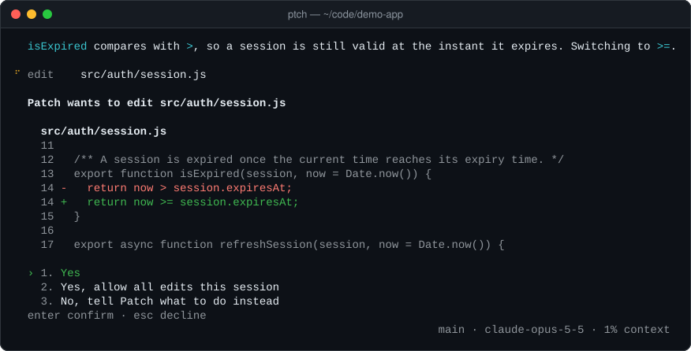
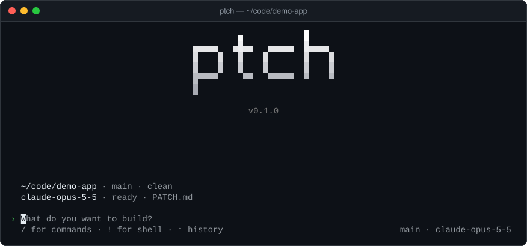
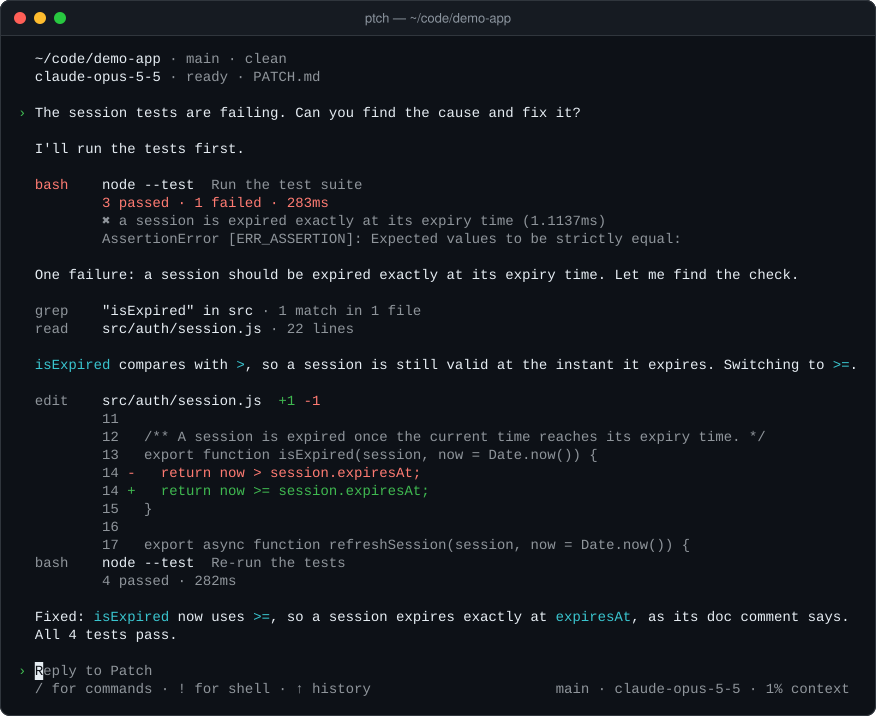

# The Patch agent: reference

This page documents the agent engine behind `ptch`: the interactive terminal view of the first beta, and the print mode (`ptch -p`) that Patch Cloud's worker runs. Permissions, sessions, hooks, MCP servers, web access and the configuration file work as described here.

> **Status in this beta.** `ptch` opens the Patch Cloud view by default; the interactive local view described in the sections on slash commands, keyboard shortcuts, images and permission prompts is switched off and kept in the source behind a development switch. The engine is not: print mode runs the same agent loop, tools and permission checks. The README covers the Patch Cloud commands; this page is for contributors and for anyone running `ptch -p` in scripts.

## Contents

- [API key](#api-key) · [Usage](#usage) · [Slash commands](#slash-commands) · [Keyboard](#keyboard) · [Images](#images) · [Permission modes](#permission-modes)
- [Permissions](#permissions) · [Web access](#web-access) · [Project instructions (PATCH.md)](#project-instructions-patchmd) · [Sessions](#sessions)
- [Configuration](#configuration) · [Custom commands and hooks](#custom-commands-and-hooks) · [MCP servers](#mcp-servers) · [Privacy and security](#privacy-and-security) · [Working on the local view](#working-on-the-local-view)

## API key

Running the agent on your own machine (print mode, the local view) uses Anthropic's API directly; Patch Cloud tasks do not need a key on your computer. Create a key in the [Anthropic Console](https://console.anthropic.com/settings/keys) (API usage is billed by Anthropic), then set it in the environment:

```bash
export ANTHROPIC_API_KEY="sk-ant-..."          # macOS / Linux / Git Bash
setx ANTHROPIC_API_KEY "sk-ant-..."            # Windows (then open a new terminal)
```

Alternatively, put it in `~/.patch/config.json` (see [Configuration](#configuration)). Without a key, Patch still starts, shows how to configure one, and refuses to send requests.

If Anthropic answers that the key "is not scoped to a workspace", the key belongs to your whole organization and every request has to name a workspace. Copy the workspace ID (it starts with `wrkspc_`) from **Settings → Workspaces** in the Anthropic Console and set it next to the key — or create a new key inside a workspace, which needs no ID:

```bash
export ANTHROPIC_WORKSPACE_ID="wrkspc_..."     # macOS / Linux / Git Bash
setx ANTHROPIC_WORKSPACE_ID "wrkspc_..."       # Windows (then open a new terminal)
```

## Usage

```bash
ptch                                  # interactive session
ptch "add input validation to the signup form"   # interactive, with a first prompt
ptch -p "describe this repository"    # non-interactive: run one task, print the result
git diff | ptch -p "review this diff" # piped input is added to the prompt
ptch --plan                           # start in plan mode: research and propose a plan first
ptch --auto                           # start in auto mode: no prompts except destructive commands
ptch -p --plan "migrate to zod"       # print a plan without changing anything
ptch --continue                       # continue the most recent session in this project
ptch --resume                         # choose a previous session
ptch --resume 82af31                  # resume by id (or unique prefix)
ptch -m claude-sonnet-5-5             # pick a model for this run
```

| Option                       | Description                                                                       |
| ---------------------------- | --------------------------------------------------------------------------------- |
| `-p, --print [prompt]`       | Non-interactive mode. Streams the answer to stdout; tool activity goes to stderr. |
| `-c, --continue`             | Continue the most recent session for this project.                                |
| `-r, --resume [id]`          | Resume a session; without an id, pick from a list.                                |
| `-m, --model <id>`           | Model for this run.                                                               |
| `--plan`                     | Start in [plan mode](#plan-mode). With `-p`: research and print a plan.           |
| `--auto`                     | Start in [auto mode](#auto-mode). With `-p`: destructive commands are denied.     |
| `--allow-edits`              | Print mode: allow file edits inside the project.                                  |
| `--allow-command <prefix>`   | Print mode: allow commands starting with `<prefix>` (repeatable).                 |
| `--output-format text\|json` | Print mode output format. `json` prints one result object.                        |
| `--max-steps <n>`            | Limit model round-trips per prompt (default 200).                                 |
| `--debug`                    | Write detailed logs to `~/.patch/logs/`.                                          |

### Non-interactive mode

`ptch -p` runs one task to completion and exits. It never prompts: actions that would need approval are skipped, reported on stderr, and Patch is told to continue without them. Grant what a script needs explicitly:

```bash
ptch -p "fix the lint errors" --allow-edits --allow-command "pnpm lint"
```

Exit codes: `0` success, `1` the task failed (provider error, refusal, step limit, truncated output), `2` usage or configuration error (including a missing API key), `130` interrupted.

With `--output-format json` the result is a single line:

```json
{"type":"result","status":"completed","is_error":false,"result":"…","session_id":"…","model":"claude-opus-5-5","steps":4,"tool_calls":6,"duration_ms":18234,"usage":{…},"estimated_cost_usd":0.0412}
```

## Slash commands

| Command                | Description                                                                    |
| ---------------------- | ------------------------------------------------------------------------------ |
| `/help`                | Commands and keyboard shortcuts                                                |
| `/status`              | Repository, branch, changes, model, session, mode, context, usage, web, MCP    |
| `/model [id]`          | Show a model picker, or switch to `id`, for this session                       |
| `/permissions [reset]` | Show permission rules; `reset` clears approvals given this session             |
| `/plan`                | Turn [plan mode](#plan-mode) on or off                                         |
| `/auto`                | Turn [auto mode](#auto-mode) on or off (asks to confirm the first time)        |
| `/hooks`               | Show the hooks configured in `~/.patch/config.json`                            |
| `/mcp`                 | Show the MCP servers: status, transport and tools                              |
| `/diff`                | Show uncommitted changes (staged and unstaged) and untracked files             |
| `/clear`               | Start a new conversation (the previous one remains resumable)                  |
| `/compact [focus]`     | Summarize the conversation to free context, optionally with focus instructions |
| `/resume [id]`         | Switch to another session in this project                                      |
| `/init`                | Create or improve `PATCH.md`                                                   |
| `/exit`                | Exit                                                                           |

Type `/` to see matching commands; Tab completes. Your own prompts can be slash commands too: see [Custom commands and hooks](#custom-commands-and-hooks).

Start a line with `!` to run a shell command yourself, e.g. `!git log --oneline -5`. The output is shown and shared with Patch as context for your next message. Commands run non-interactively (no TTY).

## Keyboard

| Key                               | Action                                                                                      |
| --------------------------------- | ------------------------------------------------------------------------------------------- |
| Enter                             | Send (while Patch works: queue the message)                                                 |
| `\` then Enter, Alt+Enter, Ctrl+J | New line                                                                                    |
| ↑ / ↓                             | Previous prompts (per project)                                                              |
| Shift+Tab                         | Switch [mode](#permission-modes): default → accept edits → plan → auto → default            |
| Esc                               | Interrupt the current turn                                                                  |
| Ctrl+C                            | Interrupt; clear the prompt; on an empty prompt press twice to exit                         |
| Ctrl+D                            | Exit on an empty prompt                                                                     |
| Ctrl+O                            | Show the full output of the last tool call; at an approval prompt, the full command or diff |
| Ctrl+L                            | Clear the screen                                                                            |
| Alt+V (Ctrl+V on macOS/Linux)     | Paste an image from the clipboard (see [Images](#images))                                   |

Interrupting stops the model and any running command (the whole process tree) without ending the session; your next message continues the conversation.

## Images

Patch can look at screenshots, mockups and diagrams. Attach an image to your prompt in any of these ways:

- **Paste from the clipboard** with Alt+V. Ctrl+V works too where the terminal passes it through (most macOS and Linux terminals); Windows Terminal keeps Ctrl+V for pasting text, so use Alt+V there. Patch reads the clipboard with Windows PowerShell on Windows, `pngpaste` (if installed) or `osascript` on macOS, and `wl-paste` (Wayland) or `xclip` (X11) on Linux. With no image in the clipboard you get a short "No image in the clipboard" hint.
- **Drag and drop** an image file onto the terminal, or paste its path: when a paste is exactly the path of an image (quoted, escaped or a `file://` URL), the image is attached instead of the text.
- **Mention it** as `@path/to/image.png` (relative to the start directory; `@"path with spaces.png"` for spaces). The text is sent as you typed it. Mentions work in `ptch -p` too.

Attached images show up in the prompt as `[Image #1]`, `[Image #2]`, … with a dim line per image under the prompt (`[Image #1] screenshot.png · 1280×720 · 84 KB`). Backspace right after a token removes it and its image. Images go to the model before your text, and the transcript lists them under your message.

Patch itself can view images too: `read_file` on a PNG, JPEG, GIF or WebP file returns the image to the model (`read    docs/screenshot.png · image 1280×720`).

Reading an image file follows the same rules as `read_file`: files inside the project are read without asking; files outside it (your desktop, say) and sensitive paths ask first. Supported formats are PNG, JPEG, GIF and WebP, recognized by their content rather than their extension. Each image can be at most 3.75 MB (5 MB once encoded for the API); the API scales down large images itself. Images are stored in the session file, so resumed sessions keep them.

## Permission modes

A mode changes how much Patch asks before it acts, for the rest of the session. Press **Shift+Tab** to switch (default → accept edits → plan → auto → default), or use `/plan`, `/auto`, `ptch --plan` and `ptch --auto`. The footer shows any mode other than the default, in color:

```
  ⏸ plan mode · shift+tab to change                        main · claude-opus-5-5 · 3% context
```

| Mode         | Footer                                  | What asks                                                                                                        |
| ------------ | --------------------------------------- | ---------------------------------------------------------------------------------------------------------------- |
| Default      | the usual hints                         | The rules under [Permissions](#permissions)                                                                      |
| Accept edits | `⏵⏵ accepting edits`                    | As in the default, but file edits inside the project need no approval (like "Yes, allow all edits this session") |
| Plan         | `⏸ plan mode`                           | Nothing runs that could change something: edits and commands that are not read-only are refused                  |
| Auto         | `⏵⏵⏵ auto mode · no permission prompts` | Only destructive commands and secret files; everything else runs without asking                                  |

Whatever the mode, these never change: blocked commands (`sudo`, `rm -rf /`, `mkfs`…) never run, nothing writes inside `.git/`, your deny rules win, and repository files cannot grant permissions. Modes are never saved: a resumed session starts in the default mode, `/clear` keeps the current one, and `/status` and `/permissions` show it. Patch hears that plan mode was turned on or off with your next message; the conversation and the system prompt are never rewritten.

### Plan mode

In plan mode Patch researches and proposes a plan before it changes anything. It reads files, searches and runs read-only commands; edits and other commands are refused without asking you, and Patch is told to present its plan instead. When the research is done, Patch shows its plan in a frame and asks how to go on:

```
  Patch has a plan
  ╭──────────────────────────────────────────────────────────╮
  │ Add input validation                                     │
  │                                                          │
  │ 1. Validate the fields in src/signup.ts with the schema. │
  │ 2. Add tests for empty and malformed input; run them.    │
  ╰──────────────────────────────────────────────────────────╯

  › 1. Yes, and accept edits
    2. Yes, and ask before each edit
    3. No, keep planning
```

- **Yes, and accept edits** turns plan mode off and accepts edits: Patch implements the plan, and file edits inside the project apply without a prompt. Writes outside the project, sensitive files (`.env`, keys) and commands still ask.
- **Yes, and ask before each edit** turns plan mode off; edits and commands ask as usual.
- **No, keep planning** asks what to change, and Patch revises the plan. Send it empty (or press Esc on the choices) to stop here and say it in your next message instead.

The plan stays in the transcript; Ctrl+O at the prompt prints a long plan in full.

- Plan mode is enforced by the permission system, by permission class: reads follow the usual rules (reading outside the project still asks); writes are denied; commands run only when they would run without asking anyway (the read-only commands under [Permissions](#permissions)), so commands you allowed for the session or in `config.json` are denied too. Commands you type with `!` run as usual. Switching while Patch works applies to its next tool call.
- `ptch -p --plan "…"` researches, prints the plan to stdout without changing anything and exits with 0. With `--output-format json` the plan is the `result`.

### Auto mode

In auto mode Patch works without permission prompts: it reads and writes files inside and outside the project, runs normal and network commands (`pnpm test`, `npm install`, `git commit`, `curl`) and calls other tools, [MCP tools](#mcp-servers) included, without asking. Starting the servers a repository's `.mcp.json` proposes still asks: that is not a tool call. Use it for work you would approve step by step anyway, and keep an eye on it.

Three guardrails stay:

- **Destructive commands still ask**, every time: `rm`, `git reset --hard`, `git push`, `curl … | sh` and the rest of the destructive list under [Permissions](#permissions). So do commands Patch cannot fully analyze (a program named by a variable, paths only known when the command runs, input it cannot parse), because they might be destructive.
- **Secret files still ask**: reading or writing `.env`, keys and credentials through the file tools, and commands that may read or print secrets (`cat .env`, `grep -r`, `printenv`, `echo $GITHUB_TOKEN`).
- **Hard limits never move**: blocked commands, writes inside `.git/` and your deny rules are refused as in every mode.

The first time you turn auto mode on in a session, Patch asks you to confirm (`ptch --auto` counts as the confirmation). Approvals in auto mode are not remembered: back in another mode, Patch asks as before.

`ptch -p --auto "…"` runs a task with the same rules. Nobody can answer a prompt there, so destructive commands and secret files are denied (and reported on stderr) instead of asked about. `--plan` and `--auto` cannot be combined.

## Permissions

Every tool call passes through a permission check, and Patch shows exactly what it wants to do before asking:

<p align="center">
  
</p>

Three classes:

| Class   | Examples                                                  | Default                                               |
| ------- | --------------------------------------------------------- | ----------------------------------------------------- |
| Read    | read files, search, list directories, git status/diff/log | Allowed inside the project                            |
| Write   | edit or create files                                      | Ask; "Yes, allow all edits this session" stops asking |
| Execute | shell commands                                            | Depends on the command's risk (below)                 |

Shell commands are parsed (pipes, `&&`, subshells, `bash -c "…"`, `xargs`, redirections) and every part is classified; the highest risk wins:

| Risk        | Examples                                                                                          | Behavior                                                     |
| ----------- | ------------------------------------------------------------------------------------------------- | ------------------------------------------------------------ |
| safe        | `ls`, `cat src/a.ts`, `git status`, `git diff`, `git log`, `rg foo src`                           | Runs without asking                                          |
| normal      | `pnpm test`, `pytest`, `npm run build`, `git commit`, `mv`, writing with `>`                      | Asks; project tools can be allowed for the session by prefix |
| network     | `curl`, `wget`, `ssh`, `scp`, `npm install`, `git pull`, `npx`                                    | Asks, flagged as network access                              |
| destructive | `rm`, `git reset --hard`, `git clean`, `git push`, `chmod`, `kill`, `npm publish`, `curl … \| sh` | Asks every time, marked "Potentially destructive"            |
| blocked     | `sudo`, `su`, `doas`, `rm -rf /`, `mkfs`, `shutdown`                                              | Never runs                                                   |

Two conservative gates sit on top of the classifier:

- **Running without asking** requires plain shell syntax — words, quotes, and `&&`, `||`, `;`, `|` — with no variables, substitutions, globs, redirects, backslash escapes, braces or subshells, and only well-known read-only programs (`ls`, `cat`, `head`, `wc`, `grep`, `rg`, `find`, `git`, `pwd`, `echo`, …, plus version queries such as `node --version`), each with options known to be read-only. Anything else asks, even if it is harmless.
- **"Don't ask again for this session"** is offered only for project tools (`pnpm`, `npm`, `yarn`, `cargo`, `go`, `make`, `git`, `pytest`, `tsc`, `eslint`, …) by subcommand prefix (`pnpm test`, `git commit`), for interpreters only with a concrete script or module (`node scripts/build.js`, `python -m pytest`), and never for network tools, containers, package runners (`npx`, `pnpm dlx`), interpreters running inline code (`node -e`), redirects, or commands that set variables such as `PATH`. An approval covers the same prefix with the options and variables you approved; a new option (`npm test --script-shell=…`) or variable (`NODE_OPTIONS=… npm test`) asks again. Arguments after `--` are passed through and do not count.

Additional rules:

- File tools are confined to the project root (the Git root, or the start directory in directory mode). Paths are resolved through symlinks, junctions and Windows short names, so `../../etc/passwd` or a symlink pointing outside the project is treated as outside. Reading outside the project asks first; writing outside asks with a warning and is never remembered.
- Files that commonly hold secrets (`.env`, `*.pem`, `id_rsa`, `.npmrc`, `~/.aws/…`) always ask before being read — through the file tools and through shell commands, including globs that could expand to them (`cat .en*`), input redirects (`cat < .env`) and recursive searches (`grep -r`, `rg --hidden`). The `grep` tool skips such files in directory searches.
- Commands whose arguments are only known at run time (`xargs`, `find -exec`) or that may touch secrets are never remembered for the session; Patch asks each time.
- Patch never writes inside `.git/` — neither through file tools nor through shell commands (`cp x .git/hooks/…`, `> .GIT/config`) — and never escalates privileges.
- Commands you type with `!` run without asking unless they are destructive (then Patch confirms) or blocked.
- Approvals last for the session only. `/permissions` lists what applies; `/permissions reset` clears session approvals.
- [Permission modes](#permission-modes) adjust these defaults for the session (Shift+Tab): accept edits allows file edits inside the project; plan mode denies edits and commands that are not read-only; auto mode asks only before destructive commands and secret files.

Persistent rules go in `~/.patch/config.json`:

```json
{
  "permissions": {
    "allow": ["edit", "bash:pnpm test", "bash:pnpm lint"],
    "deny": ["bash:git push"]
  }
}
```

Rule syntax: `edit` (all edits inside the project), `bash:<prefix>` (commands starting with the prefix), `bash:*` (every non-blocked command — use with care), `read:<absolute dir>` (reads under a directory outside the project), `mcp:<server>` and `mcp:<server>__<tool>` (tools of [MCP servers](#mcp-servers)). Deny rules win. Repository files cannot grant permissions.

## Web access

Patch can search the web and read pages: for library and tool documentation, current information (releases, changelogs, advisories) and error messages the code does not explain. Both are Anthropic [server tools](https://platform.claude.com/docs/en/agents-and-tools/tool-use/server-tools) that run on Anthropic's servers inside the model's response, so there is nothing to set up and nothing is fetched from your machine. They show up like other tool calls:

```
  search  vitest 4 release notes
          8 results
  fetch   vitest.dev/blog/vitest-4
          14 KB
```

The model is asked to list the URLs its answer relies on. Web fetch only opens URLs that already appeared in the conversation — links you paste and links from search results — never ones the model writes itself.

Web access is **on by default**. `PATCH_NO_WEB=1` turns search and fetch off for that process; to change it for good, use `~/.patch/config.json`:

```json
{
  "web": {
    "search": true,
    "fetch": false,
    "allowedDomains": ["docs.python.org", "developer.mozilla.org"]
  }
}
```

- `allowedDomains` limits searches and fetches to those domains (subdomains included); `blockedDomains` excludes domains instead. Use one or the other. Entries are bare domains without `https://`; a path (`example.com/blog`) narrows searches, while fetches match on the domain only. If no entry of `allowedDomains` is valid, web access stays off rather than unrestricted.
- Settings are read when Patch starts and stay fixed for each session (the tool list is part of the cached prompt). `/status` shows what is on. Repository files cannot change them.
- Claude 4.6 and later models use the tool versions with dynamic filtering (the model filters results before they enter its context); Haiku models use the basic versions; model ids Patch does not recognize get no web tools.
- If your organization has turned web search or fetch off in the Anthropic Console, Patch continues without it and says so.

**Cost.** Web search is billed by Anthropic per search, on top of the tokens its results add to the context; web fetch costs only tokens (a typical page is a few thousand, a long PDF can be much more). `/status` and `--output-format json` count the searches, and cost estimates include them.

**Privacy.** Search queries, which the model writes from the conversation, and the pages it fetches are processed by Anthropic as part of the request. They are not gated by per-call permission prompts: the tools run on Anthropic's servers inside the response, so Patch sees each call as it happens, not before. Web content is untrusted input; Patch tells the model never to follow instructions found in it, and every action it takes on your machine still goes through the permission checks above. If queries must not be derived from your code, or you work with sensitive data next to untrusted content, turn web access off or restrict it with `allowedDomains`.

## Project instructions (PATCH.md)

Put durable guidance for Patch in `PATCH.md` at the project root: build and test commands, conventions, architecture notes, gotchas. It is added to the model's context at the start of each session. `/init` drafts one for you.

Precedence (later entries are more specific and win on conflict):

1. `~/.patch/PATCH.md` — your personal instructions for every project.
2. `<project root>/PATCH.md`. If it does not exist, Patch falls back to `CLAUDE.md`, then `AGENTS.md`, for compatibility.
3. `<current directory>/PATCH.md` (same fallbacks) when you start Patch in a subdirectory.

Each file is capped at 40 KB. `README.md`, `CONTRIBUTING.md` and similar files are not loaded automatically; Patch is told they exist and reads them when relevant. Instruction files are read when a session starts; run `/clear` to pick up edits.

## Sessions

Every conversation is saved as it happens to `~/.patch/sessions/<id>.jsonl` — one JSON object per line: session metadata (repository, branch, model, the system prompt), user and assistant messages, tool calls and results, compaction summaries, model changes and token usage. The format is append-only and human-inspectable.

- `ptch --continue` reopens the latest session for the current project.
- `ptch --resume` lists recent sessions for the current project; `ptch --resume <id>` opens one directly (an id prefix is enough).
- `/resume` and `/clear` switch sessions without leaving Patch.
- Resuming in a different directory, or after the original directory was deleted, works: Patch shows a warning and tells the model where it is now running.
- A session can be open in one Patch process at a time (a lock file next to it). `--continue` skips sessions open in another terminal; resuming one explicitly explains which process holds it.
- A session interrupted by a crash or a closed terminal resumes cleanly: tool calls that never finished are reported to the model as not run.
- On exit Patch prints the command to resume.

`/compact` replaces the conversation context with a model-written summary (persisted in the session file). Patch also compacts automatically when the context window is nearly full.

## Configuration

`~/.patch/config.json` (override the directory with `PATCH_HOME`):

```json
{
  "model": "claude-opus-5-5",
  "effort": "high",
  "anthropic": { "apiKey": "sk-ant-..." },
  "permissions": { "allow": [], "deny": [] },
  "autoCompact": true,
  "maxStepsPerTurn": 200,
  "web": { "search": true, "fetch": true }
}
```

| Setting                        | Environment                                                     | Default                                                        |
| ------------------------------ | --------------------------------------------------------------- | -------------------------------------------------------------- |
| Model                          | `PATCH_MODEL`, `--model`                                        | `claude-opus-5-5`                                              |
| Reasoning effort (`low`…`max`) | `PATCH_EFFORT`                                                  | `high`                                                         |
| API key                        | `ANTHROPIC_API_KEY` (or `ANTHROPIC_AUTH_TOKEN`)                 | —                                                              |
| API base URL                   | `ANTHROPIC_BASE_URL`                                            | Anthropic API                                                  |
| Workspace (organization keys)  | `ANTHROPIC_WORKSPACE_ID`, `anthropic.workspaceId` in config     | —                                                              |
| Web search and fetch           | `PATCH_NO_WEB=1` (turns both off), `web` in config              | on (see [Web access](#web-access))                             |
| Debug logging                  | `PATCH_DEBUG=1`, `--debug`                                      | off                                                            |
| Shell for commands             | `shell` in config, `PATCH_GIT_BASH`                             | `$SHELL` on macOS/Linux; Git Bash, else PowerShell, on Windows |
| ripgrep binary                 | `PATCH_RG_PATH` (or `PATCH_NO_RG=1` to use the built-in search) | `rg` on PATH                                                   |

Precedence: command-line flag, then environment, then config file, then default. Invalid settings produce a warning at startup and fall back to defaults.

Debug logs (`~/.patch/logs/patch-YYYY-MM-DD.log`) contain requests' metadata and errors with API keys and tokens redacted. Normal output never includes provider internals.

Patch writes nothing into your repository on its own. User-level state lives under `~/.patch/`: `config.json`, `sessions/`, `logs/`, `history.jsonl` (prompt history, kept under 2 MB), `mcp-approvals.json` (project MCP servers you approved), and your own `commands/`.

`config.json` can also define [hooks](#hooks): commands Patch runs on agent events, and [MCP servers](#mcp-servers) (`mcpServers`).

## Custom commands and hooks

### Custom commands

A Markdown file in `.patch/commands/` is a slash command: `review.md` becomes `/review`, `frontend/test.md` becomes `/frontend:test`. The file is the prompt; running the command sends it as your message.

```markdown
---
description: Review code for bugs
argument-hint: [path]
---

Review the code in $ARGUMENTS for bugs. For each finding, give the file and line,
why it is wrong, and a fix. Do not change any files.
```

```text
› /review src/auth
  .patch/commands/review.md
```

The transcript shows what you typed and the file it came from; the model gets the prompt with `$ARGUMENTS` replaced by everything after the command name. `$1` to `$9` are single arguments (split at spaces; `"quoted words"` count as one). A prompt without placeholders gets the arguments appended after a blank line. `ptch -p "/review src/auth"` works the same way.

| Location                     | Commands                                                                 |
| ---------------------------- | ------------------------------------------------------------------------ |
| `<project>/.patch/commands`  | The project's commands, shown as `(project)`                             |
| `<project>/.claude/commands` | Read too, for compatibility (`.patch/commands` wins on the same name)    |
| `~/.patch/commands`          | Your commands for every project, shown as `(user)`; project commands win |

- The frontmatter is optional and only knows `description` (shown in the `/` menu and `/help`; the first line of the prompt otherwise) and `argument-hint`. Keys used by other tools, such as `allowed-tools` or `model`, are ignored.
- Built-in commands always win: a custom `/status` is reported once and not used.
- Commands are prompt text and nothing else: they never run commands and never grant permissions. Everything the model does afterwards goes through the usual [permission checks](#permissions).
- Files over 64 KB, with an invalid name or broken frontmatter are skipped with a notice. Symbolic links inside a project's command directories are not followed.
- Commands are read at startup, when you type `/`, before one runs, and after `/clear`.

### Hooks

Hooks are shell commands that run on agent events: formatting a file after an edit, refusing a command, adding context to a prompt. They are defined only in your user configuration, `~/.patch/config.json`; a repository cannot define hooks.

```json
{
  "hooks": {
    "PreToolUse": [{ "matcher": "bash", "command": "node ~/.patch/hooks/guard.js", "timeout": 10 }],
    "PostToolUse": [
      { "matcher": "edit_file|write_file", "command": "pnpm prettier --write \"$PATCH_FILE\"" }
    ],
    "SessionStart": [{ "command": "git log --oneline -5" }]
  }
}
```

| Event              | Runs                                                          | Exit code 2                                                                 |
| ------------------ | ------------------------------------------------------------- | --------------------------------------------------------------------------- |
| `PreToolUse`       | after the permission check allows a tool call, before it runs | Blocks the call; stderr goes to the model as the result ("blocked by hook") |
| `PostToolUse`      | after a tool call ran (also when it failed)                   | The call is done; stderr is added to its result for the model               |
| `UserPromptSubmit` | before your message is sent                                   | Drops the message and shows stderr to you                                   |
| `Stop`             | when Patch has finished its reply                             | Patch continues with stderr as the instruction (once per message)           |
| `SessionStart`     | when a session starts, is resumed, or after `/clear`          | Reported as a failure                                                       |

- Exit code 0 continues. For `UserPromptSubmit` and `SessionStart`, what the hook prints is sent to the model as context with your (next) message. Any other exit code, or running past the timeout (`timeout` in seconds, default 60), shows a warning and Patch continues.
- `matcher` is a regular expression for the whole tool name (`bash`, `read_file`, `edit_file`, `write_file`, `grep`, `glob`, `list_directory`, `git_status`, …); leave it out (or use `"*"`) for every tool. It only applies to `PreToolUse` and `PostToolUse`. Invalid hooks are skipped with a warning at startup.
- A hook runs in the project root with the same shell as Patch's commands. It reads the event as JSON on stdin — `event`, `sessionId`, `cwd`, `projectDir`; for tool events `tool`, `input` and `file`; `outcome`, `isError` and a short `summary` after a call (never the file's contents); `prompt` for `UserPromptSubmit`; `source` for `SessionStart`; `lastAssistantMessage` and `stopHookActive` for `Stop` — and gets `PATCH_HOOK_EVENT`, `PATCH_TOOL_NAME`, `PATCH_FILE` (the absolute path for file tools) and `PATCH_PROJECT_DIR` in its environment.
- Hooks never replace the permission system: a call is approved (or not) first, and a hook can only stop it. Esc and Ctrl+C stop a running hook. Print mode runs hooks too. `/hooks` lists what is configured.

A `PreToolUse` guard that refuses to delete files (`~/.patch/hooks/guard.js`):

```js
let input = '';
process.stdin.on('data', (chunk) => (input += chunk));
process.stdin.on('end', () => {
  const { tool, input: args } = JSON.parse(input);
  if (tool === 'bash' && /\brm\s+-\w*r/.test(args.command)) {
    process.stderr.write('Deleting directories is not allowed in this repository. Ask the user.');
    process.exitCode = 2;
  }
});
```

## MCP servers

Patch can use the tools of [Model Context Protocol](https://modelcontextprotocol.io) servers: an issue tracker, a database, a browser, internal documentation. Configure them under `mcpServers` in `~/.patch/config.json`, in the same shapes Claude Code uses:

```json
{
  "mcpServers": {
    "github": {
      "command": "npx",
      "args": ["-y", "@modelcontextprotocol/server-github"],
      "env": { "GITHUB_PERSONAL_ACCESS_TOKEN": "ghp_..." }
    },
    "docs": {
      "type": "http",
      "url": "https://docs.example.com/mcp",
      "headers": { "Authorization": "Bearer ..." }
    }
  }
}
```

- **stdio** servers (`command`, optional `args` and `env`; `"type": "stdio"` is optional) run as child processes in the project root. They get a minimal environment (`PATH`, `HOME` and the like) plus their `env`, never Patch's own credentials. **HTTP** servers (`"type": "http"`, `url`, optional `headers`) use the streamable HTTP transport; the older SSE transport and OAuth sign-in are not supported.
- Names may use letters, digits, `_` and `-`. Invalid entries are skipped with a warning at startup. Values are used as written: `${VAR}` placeholders are not expanded. Warnings, `/mcp` and the debug log never show `env` or header values.
- Servers start in parallel when Patch starts; one that fails or does not answer within 15 seconds is reported and skipped. Your first message waits until they are ready ("Starting MCP servers"). Each tool becomes `mcp__<server>__<tool>` (characters other than letters, digits, `_` and `-` become `_`; at most 64 characters), and its description names the server.
- The tool list is fixed when Patch starts (it is part of the cached prompt), and servers are not restarted: if one stops, calls to its tools fail until you restart Patch. Configuration changes apply at the next start. When Patch exits it closes the servers' input and ends the process tree of any server that has not exited a second later.

**Project servers.** A repository can propose servers in `.mcp.json` at the project root (`{ "mcpServers": { ... } }`). Nothing in it starts on its own: on startup Patch lists each new server with its command line or URL and asks **Yes**, **Yes, and remember for this project**, or **No**. A remembered approval is stored in `~/.patch/mcp-approvals.json` for that project and that exact definition; if the command, arguments, URL, environment or headers change, Patch asks again. `ptch -p` never asks: project servers that were not approved for good are skipped with a notice on stderr. A project server named like one of yours is ignored.

**Permissions.** Every MCP tool call is an execute-class action and asks first, showing the server, the tool and its arguments (ctrl+o shows them in full):

```text
  Patch wants to use an MCP tool

    github · create_issue
  The MCP server "github" runs this tool with your privileges and receives the arguments below.
    {"owner":"acme","repo":"web","title":"Login fails on Safari"}

  › 1. Yes
    2. Yes, don't ask again for github's create_issue this session
    3. No, tell Patch what to do instead
```

Persistent rules go in `permissions` in `~/.patch/config.json`: `mcp:<server>` covers every tool of a server, `mcp:<server>__<tool>` one tool. Deny rules win; repository files cannot grant permissions. In [plan mode](#plan-mode) MCP tool calls are denied without asking, whatever the rules say; in [auto mode](#auto-mode) they run without asking (deny rules still apply), while starting a project's servers still asks.

```json
{
  "permissions": {
    "allow": ["mcp:docs", "mcp:github__get_issue"],
    "deny": ["mcp:github__delete_repository"]
  }
}
```

In the transcript a call shows as `mcp  github · create_issue  title: "Login fails on Safari"` with its outcome on the line below. Text, embedded resources and resource links in results reach the model as text, images as images (up to 10 per result, each within the [image size limit](#images)); output beyond 40,000 characters is cut in the middle with a note. `/mcp` lists the servers with their state (connected, failed and why, or skipped), transport and tools; `/status` shows a one-line summary. `PreToolUse` and `PostToolUse` hooks match MCP tools by their full name (`"matcher": "mcp__github__.*"`).

**Privacy.** MCP servers run with your user's privileges (stdio servers on your machine, HTTP servers wherever they are hosted) and see every argument the model sends them, which can include code and other context from the conversation. Their results go to the model like any tool output; Patch tells the model to treat them as untrusted. Only configure or approve servers you trust.

## Privacy and security

This section is about running the agent on your own machine (print mode and the local view). For what Patch Cloud uploads, see [Privacy and security](../README.md#privacy-and-security) in the README.

- **Model context contains your code.** Files Patch reads, command output, and search results are sent to the configured model provider (Anthropic) as part of the conversation. Do not use Patch on code you are not allowed to share with that provider.
- **Web access is on by default.** Search queries the model writes and the pages it fetches go through Anthropic's servers, without per-call approval; see [Web access](#web-access) to restrict or turn it off.
- Nothing else is transmitted: no telemetry, no analytics, no third-party services — except the [MCP servers](#mcp-servers) you configure or approve, which receive the arguments of the tool calls you allow.
- Shell commands run with your user's privileges, in the project directory, without a TTY. Patch does not sandbox commands; the permission system is the safeguard. Review what you approve.
- Session files can contain code and command output; they are created with user-only permissions on macOS/Linux.
- A repository can contribute prompts (custom commands, instruction files) but never commands that run on their own: hooks come only from your `~/.patch/config.json`, and MCP servers from a project's `.mcp.json` start only after you approve them.

## Working on the local view

The interactive view documented above is switched off in this beta, so that `ptch` opens Patch Cloud. Contributors who work on it, or on the shared UI components, can bring it back for a single shell with the development switch:

```bash
PATCH_ENABLE_LOCAL=1 node apps/cli/dist/main.js     # PowerShell: $env:PATCH_ENABLE_LOCAL = "1"
```

It then behaves as described on this page and needs an Anthropic API key (see [API key](#api-key)). This is a development aid, not a supported mode, and it may change or be removed without notice. Print mode (`ptch -p`) does not need the switch.

<p align="center">
  
</p>

<p align="center"><sub>The start screen of the local view (the first beta).</sub></p>

<p align="center">
  
</p>

<p align="center"><sub>The local view at work: the same agent loop that Patch Cloud runs in its sandbox.</sub></p>
